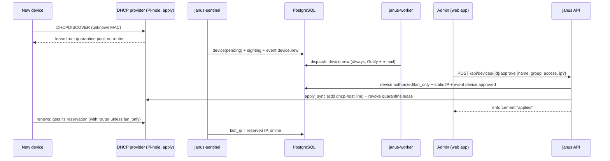
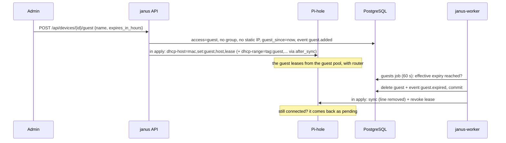
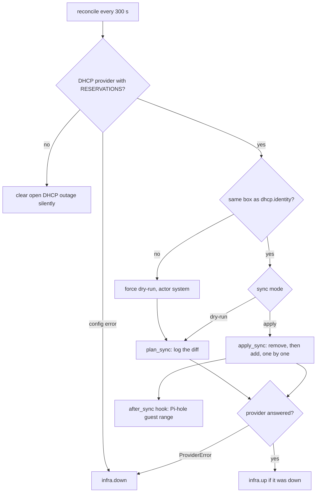
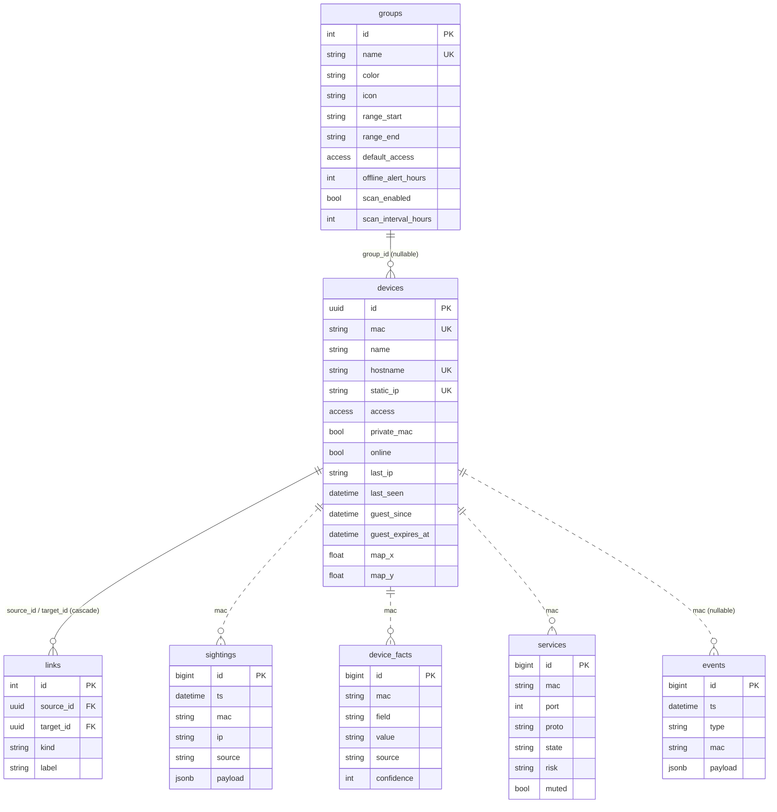

# Design

How Janus is meant to work and why it is built this way. [architecture.md](architecture.md) stays the short
operational reference (containers, jobs, providers, tables); this document adds the principles, the end-to-end
flows, the data model with its relations, the security model, the extension points and the design decisions with
the alternatives that were turned down. Feature-by-feature rules and tests are in [features.md](features.md).

A separate file was chosen over extending `architecture.md`: the architecture page is what an operator reads during
a deploy or an outage and should stay short; the material here is what a developer (or an AI agent) needs before
changing behaviour, and it would bury the operational facts.

## Principles

1. **Never in the traffic path.** Janus observes (passive sniffing plus an ARP sweep) and configures the DHCP
   provider; packets never flow through it. If every Janus container stops, the LAN keeps working with the last
   configuration the provider holds. The router stays the gateway.
2. **Dry-run first, and again after every change of box.** Janus starts in `dry-run` and computes the diff without
   writing. Only an explicit action (`cutover`, the admin switch, `janus sync-mode apply`) turns on `apply`, and
   changing the DHCP provider, or the box behind it, falls back to `dry-run` until somebody reviews the plan again.
3. **Own only what you wrote; never break the provider.** The sync engine removes only entries Janus wrote or can
   recognise as its own, reports the rest, refuses any addition that would duplicate an IP or MAC, and keeps the
   provider's DNS alive above all.
4. **Providers are plugins, features are capabilities.** Core code asks "does the DHCP role offer `QUARANTINE`?",
   never "is this Pi-hole?". A provider is a folder with a `ProviderSpec`; the frontend follows `GET /api/features`.
5. **Everything optional turns itself on.** Four variables are required; notifications, OIDC, providers, guests
   appear when configured (env or Settings) and the UI hides what is off.
6. **Env is the default, Settings is the override.** Every editable setting is an overlay: the env value applies
   until a different value is saved; saving the env value again drops the override.
7. **Local data only.** Identification uses the offline IEEE OUI file, LAN announcements and the DNS provider's
   own log; no cloud lookups.
8. **Least privilege.** Everything runs as user 1000; only the sentinel can open raw sockets (file capability on
   one binary); the scanner uses unprivileged connect scans; the API listens on loopback behind a shared token.
9. **Explain, do not guess.** Refusals are explicit (`409` with a sentence, `failed: ...` enforcement results,
   `Open question` entries in the docs) rather than silent fallbacks such as degrading `LAN_ONLY` to `FULL`.

## Containers and responsibilities

One image, four roles (`entrypoint.sh`). They share only the PostgreSQL database (data, settings, heartbeats,
events); there is no message bus between them. Redis is used only by the worker for notification debouncing.

| Container | Owns | Never does |
|---|---|---|
| `janus` (api) | better-auth and the Next.js app (`:3000`), the FastAPI API on loopback (`:8000`), migrations at start-up, approval/block/guest enforcement on request | sniff, scan or run periodic jobs |
| `janus-worker` | reconcile, presence, DNS judgement, notifications, identity, guest expiry, metrics `:9108` | serve users, touch the network except provider APIs, Gotify and SMTP |
| `janus-sentinel` | packet capture and ARP sweeps on the host network, device/sighting/event recording, DNS probe, heartbeat | write to providers, run when its network settings change (it exits and restarts) |
| `janus-scanner` | nmap connect scans, one host at a time | scan outside the subnet or outside its schedule (except manual requests) |

Details: [architecture.md](architecture.md#containers).

## End-to-end flows

### New device → quarantine → approval → reservation

In `dry-run` the API answers `enforcement: dry-run` and nothing reaches the provider; with no provider it answers
`no provider`. Without the `QUARANTINE` capability (UniFi) the device keeps the address the controller gave it until
approved; blocking uses the controller's block flag.

### Guest

### Reconcile and sync modes

### Changing the DHCP provider

1. Settings → Network providers → `PUT /api/providers/dhcp`.
2. If the current provider can serve DHCP itself (`DHCP_SERVER`), Janus asks it live whether it does
   (`dhcp_server_active`). Serving or unreachable → `409`: run `janus rollback` first, so the LAN never has two
   DHCP servers.
3. The new role config is stored; a shared DNS role (`same_as`) that the new provider cannot serve is detached onto
   its own copy of the old config.
4. Sync mode goes back to `dry-run`; the worker also records the new `dhcp.identity`.
5. The admin reviews `GET /api/sync/plan` (Settings → Access control) and switches to `apply`.

### Notification pipeline

Every component writes events to `events` in its own transaction. The worker's dispatcher reads them after a cursor
(30 s settle), decides channels (catalogue, rules, quiet hours, maintenance, readiness), defers or drops suppressed
events, debounces per type and subject for one hour in Redis, sends, and keeps transient failures for retry. The
events table is the outbox; there is no separate queue. See [features.md](features.md#f17-notifications).

### Signed-in request

Browser → Traefik → Next.js (`proxy.ts` session guard) → `app/api/[...path]` → `lib/proxy.ts` (session,
allowlist, same-origin, size, no `/api/internal`) → FastAPI on `127.0.0.1:8000` with `X-Janus-Internal-Token` →
`require_internal`. See [architecture.md](architecture.md#request-path).

## Data model

PostgreSQL schema `public` (Alembic, `backend/migrations/versions/0001`-`0009`) plus the better-auth schema `auth`
(users, sessions, accounts; created by `frontend/scripts/migrate-auth.mjs`).

Dotted relations are by MAC, not foreign keys: sightings, facts, services and events survive a device deletion
(a re-appearing MAC finds its history again) and are written by the sentinel/scanner without locking device rows.
`maintenance_windows`, `notification_rules` (PK event type + channel) and `settings` (key/value JSONB) stand alone.

### Settings keys

| Key | Written by | Meaning |
|---|---|---|
| `sync.mode` | sync mode switch, cutover/rollback, provider change, worker | `dry-run` / `apply` |
| `dhcp.identity` | worker, mode switch to `apply` | box last reviewed for DHCP (kind + URL) |
| `providers.config` | Settings → Network providers, migration 0008 | role → provider and config overrides |
| `provider.<kind>.written_macs` | sync engine | MACs Janus wrote to that provider |
| `provider.pihole.guest_range_error` | Pi-hole `after_sync` | last reported guest-range failure |
| `network.config` | Settings → Network, Groups → Guests | network overrides (F20) |
| `general.timezone`, `general.time_format` | Settings → General | display and schedule zone, 24h/12h |
| `notify.settings`, `notify.priorities` | Notifications page | switches, quiet hours, recipient, priority overrides |
| `notify.gotify`, `notify.email` | Settings → Integrations | channel overrides (secrets sealed) |
| `notify.cursor`, `notify.pending`, `notify.down_delivered` | dispatcher | outbox state |
| `auth.config` | Settings → Sign-in & users | OIDC providers (secrets sealed), allowlist |
| `guests.settings` | Groups → Guests | removal rules, colour, icon |
| `identity.cursor` | identity job | last sighting walked |
| `map.layout_version` | map positions | layout generation of saved positions |
| `gateway.mac` | sentinel | MAC registered as the gateway |
| `sentinel.heartbeat`, `dns.last_ok` | sentinel | last sweep, last DNS answer |
| `dhcp.down_since`, `dns.down_since`, `sentinel.down_since` | worker | open outages |
| `maintenance.active` | worker | a window is running |

## Security model

- **One trust boundary, at the web app.** better-auth signs users in (local password always; OIDC optional, with
  an allowlist re-checked on every request). The Next.js proxy then calls the API with a shared secret. The API
  trusts that secret completely and has **no notion of users or roles**: "admin only" (users, OIDC providers, the
  enforcement switch) is enforced in the UI and, for user management, by better-auth's admin plugin plus the
  server-side last-admin guard.
- **The API is not reachable from the network.** It binds `127.0.0.1` inside the `janus` container; the browser
  can reach only the proxied routes, never `/api/internal/*`; writes must be same-origin; bodies are capped at 1 MB.
- **Secrets at rest** (provider passwords, OIDC client secrets, Gotify token, SMTP password) are Fernet-encrypted
  with a key derived from `JANUS_SECRET_KEY` (fallback `JANUS_INTERNAL_TOKEN`); responses carry only set/unset
  booleans; event payloads carry field names only. The Pi-hole admin password for cutover/rollback is read from an
  env variable for one command and never stored. Values of `.env` never appear in docs, logs or tests.
- **Privileges.** User 1000 everywhere, `NET_RAW` dropped except for the sentinel's `janus-sniff` binary
  (`setcap cap_net_raw+ep`); the scanner runs `nmap -sT`.
- **Browser hardening.** HSTS, `X-Frame-Options: DENY`, `nosniff`, same-origin referrer, restrictive permissions
  policy (`next.config.ts`); post-login redirects only to same-origin relative paths.
- **Tests never touch the network** (socket-level guard) and the repository never contains real MACs.

## Extension points

| To add | Do this | Read |
|---|---|---|
| A router / DNS server | copy `backend/app/providers/_template/`, fill `SPEC`, implement the protocols of the declared capabilities, test with respx; optional pages in `frontend/providers/<kind>/` + one line in `registry.ts` | [providers/adding-a-provider.md](providers/adding-a-provider.md) |
| A provider HTTP endpoint or CLI command | `SPEC.router` (mounted at `/api/providers/<kind>`) / `SPEC.cli` (`register(sub)`) | same guide, "Hooks" |
| An optional area of the UI | one entry in `features.py::FEATURE_PROVIDERS`, gate the nav item (`lib/nav.ts`) or settings section (`sections/index.ts`) on it | F22 |
| A notifiable event | `record_event(...)` where it happens, an `EventSpec` in `notify/catalog.py`, a branch in `notify/render.py`, a migration seeding its `notification_rules`, a sentence in `frontend/lib/events.ts` (+ `EVENT_TYPES`) | F16, F17 |
| An editable setting with env default | an `OverlayStore` (or a field in `netconfig.NetConfig` with validation), the env field in `config.py` and `docker-compose.yml` | F20, F21 |
| A settings card | a component in `app/(app)/settings/sections/` + one line in `EXTRA_SECTIONS` | F22 |
| A periodic job | a `*_once(session_factory, ...)` function in `worker.py` and one entry in `jobs` (interval from `config.py`) | F26 |
| A table or column | model in `models.py` + a new Alembic revision; `test_migrations.py` checks they match | [../AGENTS.md](../AGENTS.md#database-migrations) |
| An access policy | `Policy` in `providers/base.py`, its mapping in `enforcement/reservations.py`, each provider's `policies`, UI gating like `lanOnlyAllowed` | F6, F7, F8 |

## Design decisions

Each decision names what was chosen, why, and what was turned down. Sources: the code and its comments, the commit
history and the existing docs.

1. **Quarantine through DHCP, not through the data path.** Unknown devices lease from a pool whose leases carry no
   router option (`dhcp-option=tag:!known,option:router`), and LAN-only devices get a tag that drops the router.
   *Rejected:* making Janus the gateway or a firewall (single point of failure for the whole LAN), and ARP
   isolation for now (listed as "Planned" in Settings; `pause_isolation` on maintenance windows is reserved for it).
   *Limit:* a device that sets a static IP by hand bypasses quarantine; `device.ip_mismatch` and `ip.conflict`
   make it visible.
2. **Dry-run by default, a runbook for the cutover, and a DHCP identity guard.** The first write to a DHCP server
   is a reviewed, reversible operation ([runbooks/cutover.md](runbooks/cutover.md)); after any change of box the
   worker falls back to `dry-run` (code comment "D9"). *Rejected:* writing as soon as a provider is configured.
3. **Line-by-line sync with ownership tracking.** Janus adds and removes single `dhcp-host` lines and remembers
   the MACs it wrote, instead of replacing Pi-hole's whole `dhcp.hosts` array, so hand-written lines survive.
   Ownership is recorded in Janus' database, not with comment markers in dnsmasq lines (code comment "ruling R28").
   UniFi has no such list, so ownership is the `janus:<policy>` note on the client.
4. **Refuse duplicate IPs/MACs instead of writing them.** dnsmasq rejects such configs and stops answering DNS
   (commit "never break Pi-hole DNS"); a refused addition lands in `sync.failed` and the rest proceeds.
5. **DNS health judged from the sentinel.** The sentinel runs on the host network like every LAN client, so its
   probe sees what devices see; a probe from a container network could pass while the LAN fails (same commit).
6. **Provider plugins with roles, capabilities and policies.** Introduced to support UniFi next to Pi-hole without
   `if kind == "pihole"` in the core: discovery by folder, a contract test over every provider, an AST check that
   core code never imports a provider, and a frontend registry for pages. Pi-hole output stayed byte-identical
   through the refactor (tests). *Rejected:* one hard-coded integration per router.
7. **DNS `same_as` DHCP.** When one appliance does both, one config and one session (Pi-hole refuses parallel
   logins, hence the shared session) so the two roles cannot drift apart.
8. **Ask the box before switching DHCP away.** The sync mode says nothing about whether Pi-hole's DHCP server is
   actually on (switching to `dry-run` never turns it off), so `save_role` asks it live and refuses when unsure.
9. **better-auth instead of NextAuth with Authentik only.** Password sign-in must work when the IdP or the backend
   is down; OIDC providers are configurable at runtime; discovery is probed with a timeout so a hanging IdP never
   stalls every auth request; account linking is off so an IdP account never takes over a local user; the first
   allowlisted OIDC user becomes admin so an upgraded install is not left without one.
10. **Env defaults with overrides in the database.** Editable without a restart, still configurable from `.env`
    alone, and "back to env" is just saving the env value. *Rejected:* env-only (no runtime edits) and DB-only
    (no reproducible deploy).
11. **Secrets encrypted with a key that falls back to the internal token.** Zero extra configuration for existing
    installs; `JANUS_SECRET_KEY` decouples them when the token must rotate (documented consequence: rotating the
    key in use orphans stored secrets).
12. **One image, four containers, coordination through PostgreSQL.** Each role has its own privileges (host
    network and raw sockets only for the sentinel) and health check, and they need no RPC: settings, heartbeats,
    outages and events are rows. *Rejected:* a message broker; Redis is used only for debouncing.
13. **Events as the outbox.** Notifications are a cursor over `events`, so every alert is also in the log, a
    restart loses nothing, and the first run starts at the newest event instead of replaying history.
14. **Unprivileged, scheduled scanning.** `nmap -sT -sV --top-ports 200`, one host at a time, inside a daytime
    window and outside quiet hours and maintenance; the first scan is a silent baseline. *Rejected:* SYN scans
    (need `NET_RAW`) and continuous scanning (noise, battery of IoT devices).
15. **Guests as tagged dnsmasq entries (variant A).** A MAC-only `dhcp-host=...,set:guest,...` line plus one
    `dhcp-range=tag:guest,...` line, leaving Pi-hole's own quarantine range untouched, verified with dnsmasq 2.92 in
    `backend/tests/spikes/dnsmasq_guest/`. *Rejected:* variant B (tagging the quarantine range too), which works but
    would make Janus own both ranges and replace Pi-hole's own.
16. **No roles in the API.** The API trusts the internal token; admin-only actions are a UI rule
    ([configuration.md](configuration.md#other-settings)). Adding roles would mean forwarding the user to FastAPI;
    treat it as a deliberate gap, not an accident.
17. **Local identification only.** Vendors from the offline IEEE file, identity from passive announcements, DNS
    from the provider's log: no device data leaves the LAN.
